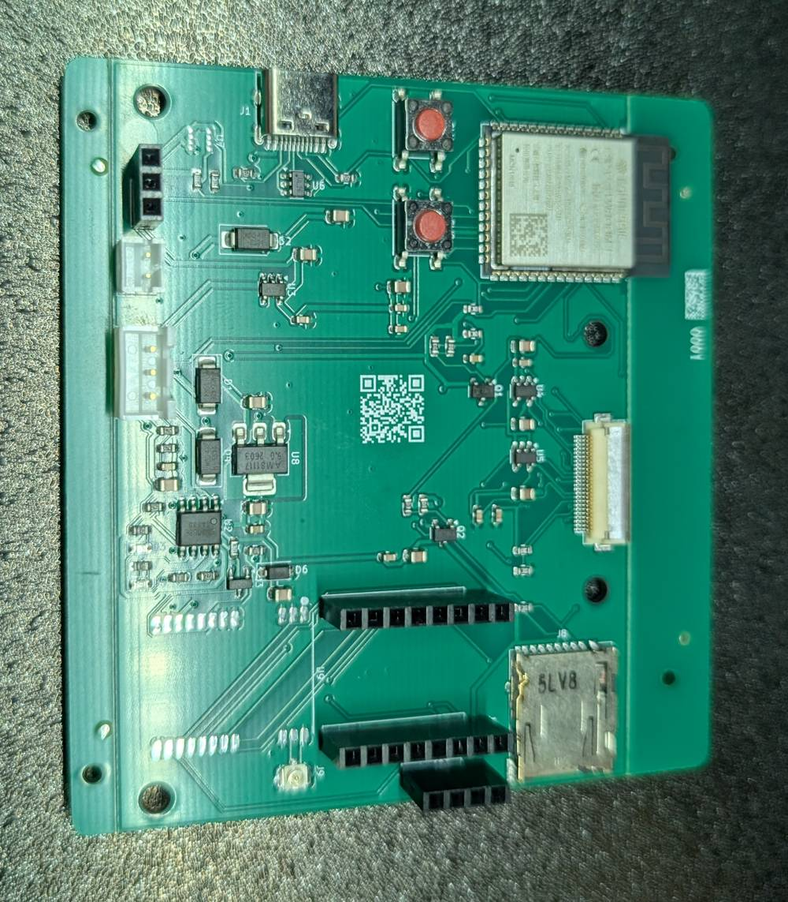

# Start here

A MeshCam node is a solar trail camera that sends its photos over its own
long-range radio mesh. No cell plan, no Wi-Fi in the woods. A gateway at the
house pushes the images to the app.

We sell the board. You build the node. This guide is how.

## What you are building

The leaf board arrives flashed, tested, and with its antenna in the box. You
add a camera module, a motion sensor, a weather sensor, a battery cell, a
solar panel, a microSD card, and an outdoor box to put it all in. The
finished node sleeps on a tree, wakes when something walks past, takes a
photo, and radios it home.

Nothing in this guide needs a soldering iron. Every connection is a plug.
The only tools you need are for the box: a drill, a step bit, a knife, and a
tube of silicone.

## How long it takes

About an hour at the bench, plus a day in a sunny window to charge the cell,
plus an overnight cure for the silicone before the node goes outside.

## The order matters

The chapters run in build order, and the order is deliberate:

1. [Parts list](parts.md). What is in the box, what you buy, and what to
   avoid.
2. [Battery and solar](battery-and-solar.md). Fit the cell first and let the
   sun charge it. The board is not USB-powered; USB is an optional top-up,
   not the first step.
3. [First boot](first-boot.md). Plug in the modules, insert the card, and
   watch the node join the mesh.
4. [Deploying](deploying.md). Drill the box, seal it, mount it.
5. [Troubleshooting](troubleshooting.md). What the lights mean, and the few
   things that go wrong.

## If you get stuck

Every page of this guide lives in a public repository. If a step is wrong or
unclear, open an issue there and we fix it for everyone. For a board that
will not come to life at all, read the dead-on-arrival check in
[Troubleshooting](troubleshooting.md#dead-on-arrival) and email
hello@getmeshcam.com with the serial number on the board.

<!-- Photo plan for this page: one dressed node on a tree (the "where this is
going" shot). Needs the bench photography afternoon. -->
