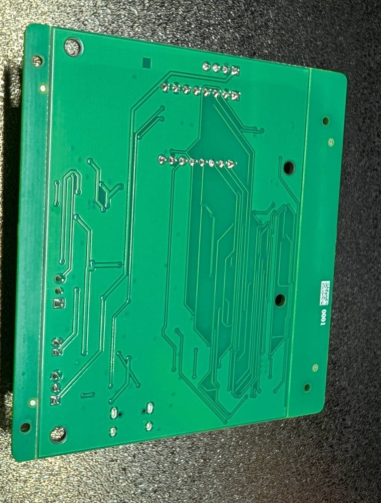

# Parts list

Everything a node needs, split by where it comes from. The board's connector
labels (J1, J2, and so on) are printed on the board and used throughout this
guide. The full connector map is on the
[pinout page](https://docs.getmeshcam.com/pinout).

## In the box

- The leaf board, flashed and tested, with a serial number label.
- A 915 MHz whip antenna and a u.FL-to-RP-SMA bulkhead pigtail. The antenna
  that ships is the one the board's radio certification covers. Do not
  substitute a higher-gain antenna.

## From the MeshCam shop, or anywhere that sells them

These are ordinary modules. We sell them because we have tested the exact
ones we ship; the same parts from any supplier work if they match.

| Part | Plugs into | Notes |
|---|---|---|
| OV2640 camera module, 24-pin ribbon, about 75 mm long | J2 | Any OV2640 module on a 24-pin 0.5 mm ribbon fits. |
| AM312 motion (PIR) sensor with a 3-wire lead | J3 | The white dome is the sensor. The lead ends in a 3-pin JST-PH plug. |
| BME280 temperature, humidity and pressure module | J10 | 4-pin, 2.54 mm header. |
| Solar pigtail, 2-pin JST-XH | J6 | Goes between the panel and the board. |
| Sensor pigtail, 3-pin JST-PH | J3 | Only if your motion sensor did not come with a lead. |

## You source these yourself

| Part | Notes |
|---|---|
| One IFR26650 LiFePO4 cell | **Lithium iron phosphate, 3.2 V nominal, 26650 size.** Not a Li-ion 26650 (3.7 V). The charger on the board is built for LiFePO4 and a Li-ion cell in it is a safety hazard. Buy from a seller you trust; counterfeit cells are common. |
| A 6 V, 2 W solar panel | With bare leads or a 2-pin JST-XH plug. This is the node's power source; the cell is just the buffer. |
| A microSD card | Any size. **Cards larger than 32 GB must be reformatted FAT32 first.** See [First boot](first-boot.md#the-microsd-card). |
| An outdoor box | UV-stable polycarbonate, hinged lid, with cable glands. We build in a Newhouse Electric NHWE-M (220 × 160 × 120 mm). Cheap ABS chalks out in two seasons. |
| A 1 in (25 mm) clear acrylic disc | The lens window. |
| A foam ring to fit the camera lens barrel | A light seal between the lens and the window. |
| Neutral-cure silicone | The "window and door" kind. Not the vinegar-smelling kind; see [Deploying](deploying.md). |
| An ePTFE vent plug and a desiccant pack | So the box can breathe without fogging. |
| Nylon standoffs and an adhesive to bond them | To mount the board inside the lid without drilling through the weather face. |

## Optional: USB

The board charges from the sun. If you want to top the cell up faster, or
read the node's console on a computer, you also need:

- A USB-A wall charger. **A wall charger, not a power bank.** Power banks
  switch themselves off below the charger's tiny idle draw.
- A USB-A-to-USB-C cable. **Not a C-to-C cable.** The board is a simple 5 V
  load with no negotiation chip, and many C-to-C cables will never turn the
  power on for it. A-to-C always does.

## Tools

- Cordless drill with a step bit (for the lens and sensor ports).
- A sharp knife or deburring tool.
- A small Phillips screwdriver.
- A scrap board to drill against.
- A computer with a USB port (optional, for the console).
